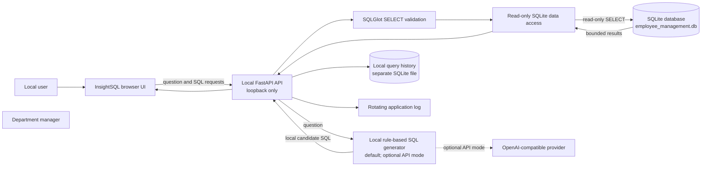
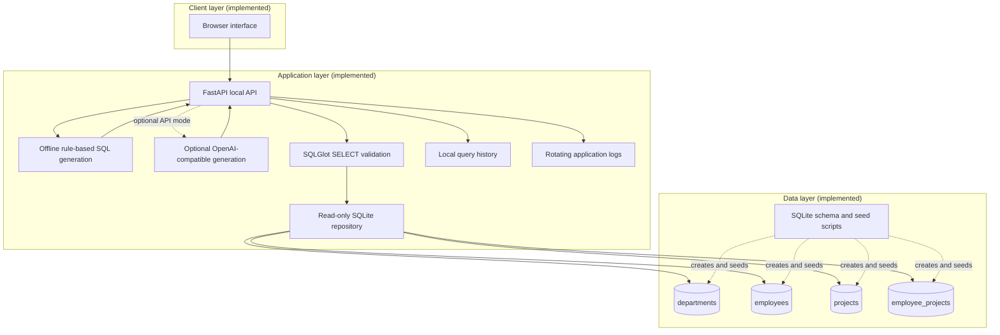
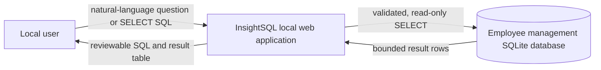
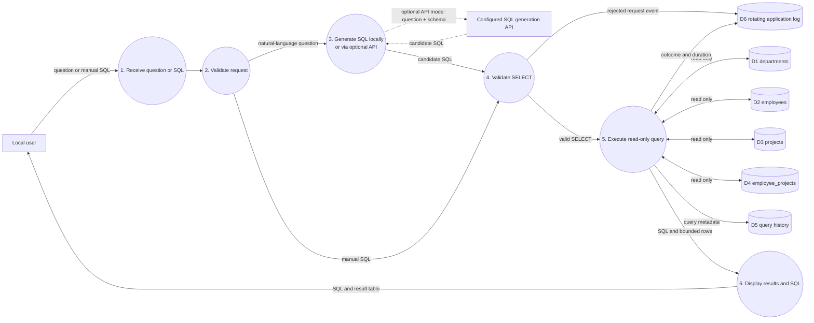

# Employee Management System Architecture

## Scope and assumptions

This repository contains the InsightSQL local web application, a SQLite database, SQL Server and SQLite schema/seed scripts, and documentation. The UI, local API, offline SQL generation, SQL validation/execution, query history, and rotating operational log are implemented. An OpenAI-compatible model provider is optional and disabled by default. The app does not implement end-user accounts or role-based authentication; it binds to loopback and rejects non-local clients.

## Architecture diagram



Offline mode generates SQL locally for supported question types and makes no external API calls, even if an API key is present. Optional API mode sends the question and database schema to the configured provider. In both modes, generated SQL is validated locally and presented for review before execution. The SQLite database is opened read-only; query history and operational logs are separate local files. Backups and end-user identity management remain deployment responsibilities.

## Component diagram



The `employees.manager_id` foreign key provides an optional self-reference for reporting relationships. `employee_projects` joins employees and projects and stores the employee's project role, allocation, and assignment dates.

## Data flow diagrams

### Level 0 — system context



### Level 1 — employee/project data flow



InsightSQL defaults to local rule-based generation and makes no API calls in offline mode. The optional model provider generates SQL but does not execute it directly: the user reviews the SQL, and local validation runs before SQLite execution. The database enforces its keys and check constraints, but does not implement user-level access control.

## Folder structure

### Current repository

```text
dbinsight/
├── ARCHITECTURE.md
├── README.md
├── employee_management.db
├── insightsql/
│   ├── config.py
│   ├── database.py
│   ├── history.py
│   ├── llm.py
│   ├── main.py
│   ├── sql_safety.py
│   └── static/
├── tests/
├── pyproject.toml
├── .env.example
└── sql/
    ├── schema.sql
    ├── seed.sql
    ├── sqlite_schema.sql
    └── sqlite_seed.sql
```

### Deployment extensions (optional)

```text
dbinsight/
├── docs/
│   └── ARCHITECTURE.md
├── src/
│   ├── api/                 # HTTP endpoints and request/response types
│   ├── services/            # Business rules and authorization checks
│   ├── repositories/        # Parameterized database queries
│   ├── validation/          # Input validation
│   └── logging/             # Structured logging configuration
├── sql/
│   ├── schema.sql
│   ├── seed.sql
│   ├── sqlite_schema.sql
│   └── sqlite_seed.sql
├── tests/
│   ├── integration/
│   └── unit/
├── data/                    # Local database; exclude from source control if it contains real data
├── logs/                    # Runtime logs; exclude from source control
└── README.md
```

Keep production database files, backups, logs, and provider credentials out of public/source repositories when they contain real employee information.

## Security strategy

1. **Use least privilege.** Restrict read/write access to the database file and its containing directory to the application identity and authorized operators. SQLite has no built-in database user accounts or table-level grants; enforce user permissions in the application and operating system.
2. **Keep the current local boundary.** The app binds to loopback and rejects non-local clients. This is not end-user authentication. Do not expose it to a network or shared machine without adding authenticated users, authorization, CSRF protections, and deployment-specific controls.
3. **Use parameterized SQL.** Bind values instead of concatenating user input into SQL. Allowlist any user-selectable sort columns or SQL identifiers, which generally cannot be passed as bound values.
4. **Validate and constrain data.** Validate format, length, allowed status values, and date ranges at the application boundary. Keep database `NOT NULL`, `UNIQUE`, `CHECK`, primary key, and foreign key constraints enabled as defense in depth. Enable `PRAGMA foreign_keys = ON` on every SQLite connection.
5. **Protect employee information.** Collect only required fields. Do not put credentials, sensitive personal information, or full employee records into logs, error messages, sample data, or source control. Restrict exports and report access.
6. **Protect data at rest and in transit.** SQLite does not provide built-in encryption at rest. Use full-disk encryption for local deployments; for portable or server deployments with stronger file-level requirements, use a vetted encrypted SQLite build (such as SQLCipher) and manage encryption keys outside the database file. Use TLS if the application communicates over a network.
7. **Back up and recover safely.** Create access-controlled, encrypted backups on a defined schedule. Use SQLite's backup API or another SQLite-consistent backup method, and periodically test restore and integrity checks. Never treat a copied, actively written database file as a verified backup.
8. **Patch and review.** Keep the SQLite library, application framework, and dependencies current. Review schema and permission changes; test backup restoration and access-control behavior before release.

## Logging strategy

InsightSQL writes rotating operational logs outside the employee database; query text, generated SQL, API keys, and result rows are not logged. Query history is separately stored locally and includes user questions and SQL.

- Emit structured events with UTC timestamps, severity, event name, application version, request/correlation ID, and outcome.
- Record authentication outcomes, authorization denials, validation failures, schema/migration changes, backup/restore outcomes, and database errors. For data changes, record the actor, affected entity type/ID, action, and outcome in an access-controlled audit stream where appropriate.
- Do not log passwords, tokens, encryption keys, full SQL parameters, or unnecessary employee personal data. Prefer internal IDs and redacted summaries.
- Send logs to an access-controlled destination separate from the SQLite file. Restrict access, define retention and deletion periods, and configure rotation/size limits to prevent disk exhaustion.
- Report database exceptions with enough operational context to troubleshoot, while returning generic, non-sensitive errors to end users. Preserve transaction rollback and record failed writes without logging sensitive payloads.
- Alert on repeated authorization failures, unexpected schema changes, failed backups, database integrity errors, and sustained database failures.
- Keep audit records tamper-resistant for the deployment's risk level; SQLite alone does not provide tamper-proof audit logging.
