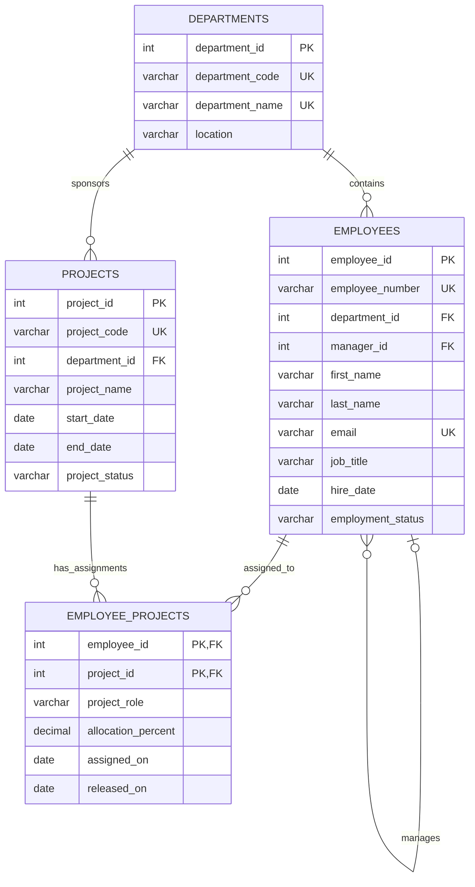

# Employee Management Database

This design includes Microsoft SQL Server scripts and a populated SQLite database. It models departments, employees, projects, and employee assignments to projects.

See [`ARCHITECTURE.md`](ARCHITECTURE.md) for architecture, component and data-flow diagrams, folder structure, and security and logging strategies.

## ER diagram



`EMPLOYEE_PROJECTS` is the many-to-many junction table. Its composite primary key prevents duplicate assignments of the same employee to the same project. An employee can optionally reference another employee as their manager.

## Tables, keys, and constraints

| Table | Primary key | Foreign keys | Purpose |
|---|---|---|---|
| `departments` | `department_id` | — | Department reference data. Department code and name are unique. |
| `employees` | `employee_id` | `department_id` → `departments`; `manager_id` → `employees` | Employee profile and reporting line. Employee number and email are unique. |
| `projects` | `project_id` | `department_id` → `departments` | Projects sponsored by a department. Project code is unique. |
| `employee_projects` | (`employee_id`, `project_id`) | `employee_id` → `employees`; `project_id` → `projects` | Employee-to-project assignments, role, allocation, and assignment dates. |

Status and percentage fields have check constraints. Foreign keys use the default `NO ACTION` behavior, preventing deletion of referenced departments, employees, or projects.

## Scripts and database

- [`sql\schema.sql`](sql/schema.sql) creates the four tables and supporting indexes.
- [`sql\seed.sql`](sql/seed.sql) inserts 5 departments, 20 employees, 10 projects, and 30 employee-project assignments.
- [`sql\sqlite_schema.sql`](sql/sqlite_schema.sql) creates the equivalent SQLite tables, constraints, and indexes.
- [`sql\sqlite_seed.sql`](sql/sqlite_seed.sql) loads the same sample records into SQLite.
- [`employee_management.db`](employee_management.db) is the populated SQLite database.

The SQL Server scripts target SQL Server. The SQLite database is built from its corresponding scripts. Run each schema script once against a fresh database, then its seed script. Seed scripts use explicit IDs and are intended for a fresh schema; running them more than once will conflict with existing primary keys.

## InsightSQL application

InsightSQL is a local-first Python application for natural-language questions against the employee-management SQLite database. It displays the generated SQL for review before execution, validates it as a single SELECT against the four application tables, executes on a read-only SQLite connection, and displays a bounded result set. Query history is stored locally in a separate database and does not store result rows.

### Setup on Windows

From the repository folder in PowerShell:

```powershell
py -3.13 -m venv .venv
.\.venv\Scripts\Activate.ps1
python -m pip install --upgrade pip
python -m pip install -e ".[dev]"
Copy-Item .env.example .env
```

InsightSQL defaults to offline mode and requires no API key. Its built-in local SQL generator supports common employee, department, project, status-count, and employee-project assignment questions. It does not send questions or database schema to an external service in offline mode, even if an old API key is still present in `.env`. For more flexible natural-language questions, explicitly set `INSIGHTSQL_LLM_MODE=api`, configure `INSIGHTSQL_LLM_API_KEY`, and set `INSIGHTSQL_LLM_BASE_URL` and `INSIGHTSQL_LLM_MODEL` for an OpenAI-compatible provider. Do not commit the API key. Then start the app:

```powershell
python -m insightsql.main
```

Open [http://127.0.0.1:8000](http://127.0.0.1:8000). By default the server accepts local connections only. In offline mode, supported question types are handled locally and no API request is made. In API mode, natural-language questions and the database schema are sent to the chosen provider. Manually entered SQL works in both modes. Review the provider's data-handling terms before using external generation with non-sample employee data.

### Safety and operations

The SQL parser rejects statements other than a single SELECT and restricts reads to the employee tables. SQLite connections use read-only mode, `query_only`, resource limits, a query timeout, and a maximum row count. The SQL validator is a guardrail for this application, not an isolation boundary for untrusted users. The API binds to loopback and rejects non-local clients; add authentication and deployment-specific controls before exposing it beyond the local machine.

Copy `.env.example` to `.env` to configure the database, provider, and resource limits. The default database is `employee_management.db`; the default history and rotating application logs are stored under ignored `data/` and `logs/` directories. History retains query text and SQL for up to 30 days and is capped by `INSIGHTSQL_HISTORY_LIMIT`; it deliberately does not save result values. Provider API keys and question text are not written to application logs.

Run the test suite with:

```powershell
python -m pytest
```
